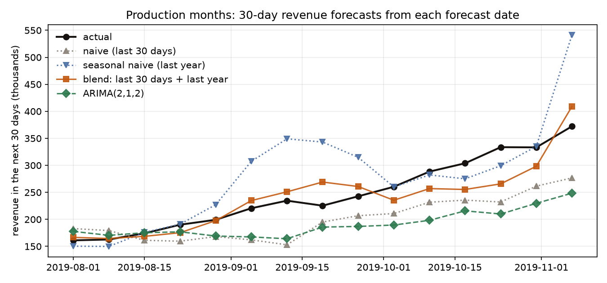
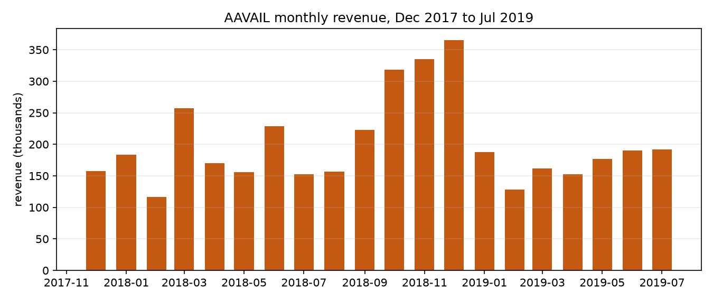

# AAVAIL revenue forecasting: 30-day revenue, tested honestly

[](https://github.com/engomaressam/aavail-revenue-forecasting/actions/workflows/tests.yml)

Capstone of IBM's *AI Enterprise Workflow* specialization (its final course, *AI Workflow: AI in Production*). AAVAIL, a fictional video-streaming company moving to à-la-carte billing, wants the revenue of the next 30 days predicted from any date, for all countries or one. The project goes from raw monthly invoice files to a tested forecasting API in a Docker container, with a backtest and a check on months the models never saw.



## What the data says

IBM's data has 815,008 invoice lines (42,643 invoices, 5,225 customers, 43 countries) from 28 Nov 2017 to 31 Jul 2019, plus five "production" months (Aug to early Dec 2019) held back for the final check (`scripts/eda.py`).

- The United Kingdom carries 90.3% of revenue; the next nine countries together carry 7.5%.
- Revenue peaks in the fourth quarter (December 2018: 365k against a typical 150–190k) and 2019 ran below 2018.
- Saturdays are almost dead (1,443 a day on average against 9,504 on Mondays), and 116 days have no sale at all.



## How the models were compared

Every method forecasts the same thing, **the revenue of the 30 days after a forecast date**, from the history before it (`src/evaluation.py`):

- forecast dates are weekly, over the last 20% of the training months (16 dates from 13 Mar 2019 for all countries);
- training windows for the learned models end before the first forecast date, so no test revenue leaks into training;
- ARIMA and Holt-Winters are refit at every forecast date;
- the error is MAE and WAPE (total absolute error ÷ total revenue), because small countries have 30-day windows with no revenue at all and MAPE divides by zero there.

The methods: a **naive** baseline (next 30 days = last 30 days), a **seasonal naive** (the same 30 days last year), a **50/50 blend** of the two, the seasonal naive scaled by recent growth, ridge regression, random forest and gradient boosting on the last 30 daily values, a ridge on weekly and last-year features, ARIMA(2,1,2) and Holt-Winters with weekly seasonality.

## Results

**Backtest, all countries together** (16 forecast dates, Mar–Jul 2019):

| Method | MAE | WAPE | vs naive |
|---|---|---|---|
| ARIMA(2,1,2) | 16,162 | 9.3% | −13% |
| naive (last 30 days) | 18,599 | 10.7% | — |
| blend: last 30 days + last year | 22,463 | 13.0% | +21% |
| Holt-Winters (weekly) | 28,754 | 16.6% | +55% |
| random forest | 41,593 | 24.0% | +124% |

Across the 11 series (all countries plus the ten largest), the naive baseline is hard to beat: ARIMA averages 5.5% below its error, everything else averages above it, and the winner changes from country to country (`results/backtest_by_series.csv`). The learned models win some small countries and lose badly on the total; with 20 months of history there is not enough data for them.

**Production months** (Aug–Nov 2019 forecast dates, 15 of them; retrained on all training months):

| Method | MAE | WAPE | Bias |
|---|---|---|---|
| **blend: last 30 days + last year** | **24,417** | **9.9%** | −6,212 |
| seasonal naive (last year) | 45,732 | 18.5% | +33,310 |
| naive (last 30 days) | 50,843 | 20.6% | −45,734 |
| ARIMA(2,1,2), the backtest's pick | 59,183 | 24.0% | −55,800 |

The production months run into the Q4 peak. Everything that looks only at recent days (naive, ARIMA) misses the rise, and last year alone overshoots because 2019 was weaker than 2018; the two errors point in opposite directions, so their average lands close. **A caveat that matters:** the blend was added after the first look at these production numbers, so its 9.9% is not an untouched out-of-sample result. On the backtest, which was set up first, it was 21% worse than naive. The honest summary is that one year of history cannot pin down yearly seasonality, and a simple, explainable combination is the safest default until more data arrives.

## The API

`src/model_api.py` (Flask, served by gunicorn in Docker):

| Endpoint | What it does |
|---|---|
| `GET /health` | status, whether data is loaded, its date range, the available methods |
| `POST /train` | loads the invoices (`{"data_dir": ...}`, default `data/cs-train`) and backtests the cheap methods on all countries |
| `POST /predict` | `{"country": "all" or a name, "date": "YYYY-MM-DD", "method": "blend" / "naive" / "seasonal" / "arima"}` → the 30-day forecast from that date, and the actual and the error when the data already covers those days |
| `GET /logs` | `?kind=train` or `predict` and `&month=YYYY-MM`: the API's own log, one JSON line per training or prediction |

The default method is the blend. A forecast needs a year of history before its date (for the last-year half) and can be made up to the day after the data ends.

## Run it

Get the data from IBM's public repository [aavail/ai-workflow-capstone](https://github.com/aavail/ai-workflow-capstone) and copy its `cs-train/` and `cs-production/` folders into `data/`.

```bash
pip install -r requirements.txt
python scripts/eda.py          # figures/monthly_revenue.png, results/country_revenue.csv
python scripts/evaluate.py     # backtest + production check: results/*.csv, figures/*.png (about a minute)
pytest                         # 24 tests: ingestion, the methods and the split, the API
docker build -t aavail-forecast . && docker run -p 8080:8080 aavail-forecast
curl -X POST localhost:8080/train -H "Content-Type: application/json" -d "{}"
curl -X POST localhost:8080/predict -H "Content-Type: application/json" -d "{\"date\": \"2019-06-01\"}"
```

## What changed when this was finished (October 2026)

I first built this in September 2025. Re-running it to publish it showed problems, fixed here:

- **A fifth of the revenue was missing.** Five monthly files name the revenue column `total_price` instead of `price`, and ingestion dropped them: 3.16 M of revenue instead of 4.05 M, including both Decembers. `src/data_ingestion.py` now maps the column, and a test covers it.
- **The model comparison was not a comparison.** ARIMA was scored on daily values over four months, the tree models on 30-day sums, and the winner was picked by MAPE across the two. `src/evaluation.py` replaces it with the backtest above.
- **The old reports' numbers (9.2% MAPE, "91% accuracy") were not produced by any code** and are gone, with the reports. Every number in this README comes from `scripts/evaluate.py` and `scripts/eda.py`.
- **The API ignored the requested date** and returned a ±15% band that was not computed from anything; it now forecasts from the date asked for, and trains on AAVAIL's invoices rather than a different retail dataset.
- **The EDA module and notebooks were written for the UCI Online Retail columns**, not AAVAIL's, and are replaced by `scripts/eda.py`.

Kept from the first version: the ingestion module (with the fix) and its tests, the Docker approach, and the choice of a 30-day target from the last 30 days.

---

Omar Essam El Sherbiny · [omaressam.web.app](https://omaressam.web.app) · [LinkedIn](https://www.linkedin.com/in/omar-essam-el-sherbiny-b602279b/)
